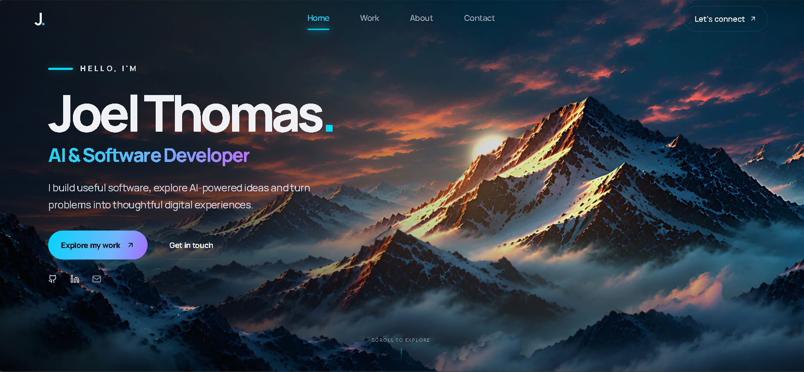

# Joel Thomas — Portfolio

Personal portfolio of **Joel Thomas**, an AI & Software Developer and Computer Science student. This site showcases selected projects, technical interests, and experiments in software development.

**Live website:** https://joel-portfolio-beige.vercel.app  
**GitHub:** https://github.com/Joelthomask  
**LinkedIn:** https://www.linkedin.com/in/joel-thomask/

## Homepage

<!-- Add a screenshot of the homepage at docs/screenshots/homepage.png -->




## What you'll find here

- **About:** A little about me and the kind of problems I enjoy working on.
- **Projects:** Selected work across full-stack development, AI, computer vision, and databases.
- **Toolkit:** Technologies and tools I explore and use.
- **Project Lab:** A closer look at project details, screenshots, features, and technology choices.
- **Contact:** Ways to connect with me.

## Tech stack

- React
- TypeScript
- Vite
- CSS
- Three.js

## Run locally

Requires Node.js 22.x.

```bash
git clone https://github.com/Joelthomask/joel-portfolio.git
cd joel-portfolio
npm install
npm run dev
```

Open the local URL printed by Vite (usually `http://localhost:5173`).

To create a production build:

```bash
npm run build
```

---

Made by **Joel Thomas**.
